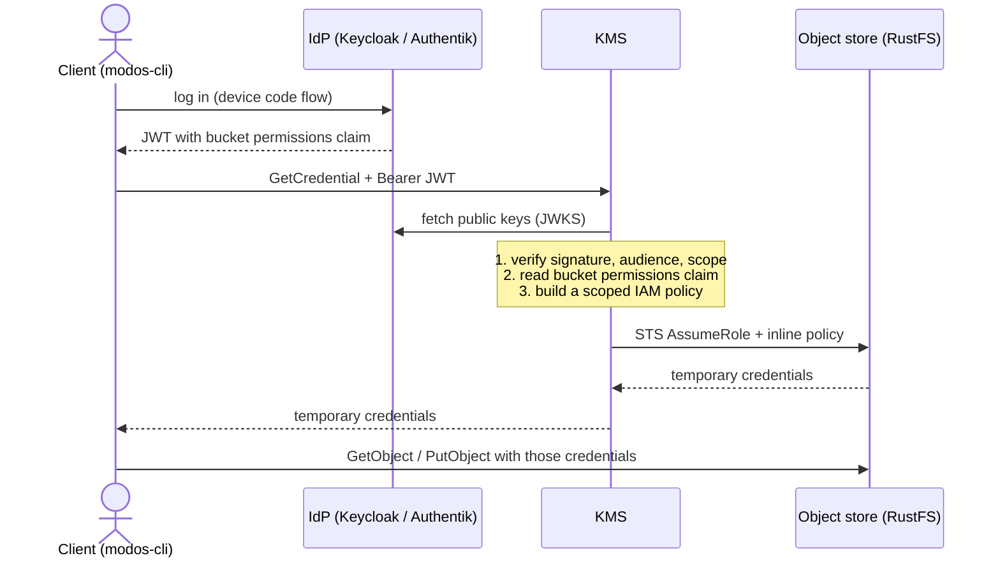

# KMS — Key Management Service

<!--toc:start-->

- [KMS — Key Management Service](#kms-key-management-service)
  - [Interface](#interface)
  - [How a Request Is Handled](#how-a-request-is-handled)
    - [1. Authentication](#1-authentication)
    - [2. The Bucket Permissions Claim](#2-the-bucket-permissions-claim)
    - [3. The Scoped Policy](#3-the-scoped-policy)
    - [4. Getting the Credentials](#4-getting-the-credentials)
  - [Startup](#startup)
  - [Configuration](#configuration)
  - [Build Tags](#build-tags)
  - [Commands](#commands)
  - [Glossary](#glossary)
  <!--toc:end-->

The KMS is a Go service in [`components/kms`](/components/kms). It hands out
short-lived S3 credentials over the Secret Token Service (STS). A client
authenticates with a JWT. The KMS reads the bucket permissions from that token
and asks the object store for temporary credentials which allow exactly these
permissions and nothing more. The JWT encodes the bucket permissions in a claim
called `bps`.

The client never sees a long-lived S3 access key. The only long-lived S3 key in
the system belongs to the KMS itself, namely the `kms-broker` account which
hands out these tokens.

- [Glossary](./glossary.md) for all abbreviations used in this document.

## Interface

The KMS serves gRPC. The API is defined in
[`api/kms/v1/kms.proto`](/components/kms/api/kms/v1/kms.proto):

The Go bindings in `pkg/api` are generated from this file with `buf`:

```bash
just generate # runs `buf generate` inside `components/kms`
```

The service opens two TCP listeners:

| Listener     | Config key         | Port | Content                                              |
| ------------ | ------------------ | ---- | ---------------------------------------------------- |
| `Public`     | `server`           | 3000 | The `kms.v1.KMS` service and gRPC server reflection. |
| `management` | `serverManagement` | 3020 | The gRPC health service and server reflection.       |

The development config
[`data/config/config.yaml`](/components/kms/data/config/config.yaml) sets all
configuration for the service.

## How a Request Is Handled



Every unary RPC passes two interceptors, in this order
([`internal/grpc/server.go`](/components/kms/internal/grpc/server.go)):

1. **Authentication**
   ([`internal/grpc/auth.go`](/components/kms/internal/grpc/auth.go))
2. **Request validation** — `protovalidate`, which enforces the rules written in
   the `.proto` file.

### 1. Authentication

The interceptor reads the `authorization` entry from the gRPC metadata and
strips the prefix `Bearer `. A missing or empty value is answered with the gRPC
status code `Unauthenticated`.

The token is then verified against the configured OIDC issuer. The verifier is
created once at startup and fetches the issuer's public keys (JWKS), so the KMS
holds no shared secret with the IdP. Verified are:

- the signature, against the issuer's public keys,
- the signing algorithm, which must be one of `oidc.trustedAlgorithms` (default:
  `EdDSA`, `RS256`, `RS512`, `ES256`),
- the audience (claim `aud`), which must be one of `oidc.trustedAudiences` —
  `oidc.clientID` is always accepted,
- the scopes. Each method declares the scopes it needs in
  [`internal/grpc/scope-mapping.go`](/components/kms/internal/grpc/scope-mapping.go).
  `GetCredential` needs the scope `permissions`.

The extracted claims are put on the request context and are read by the handler
with `grpc.Claims(ctx)`.

### 2. The Bucket Permissions Claim

The permissions are not stored by the KMS. They are carried inside the JWT, in
one custom claim. The claim is a list of objects. Its name and its keys are
configurable under `oidc.claimBucketPermissions`; with the defaults the claim
looks like this:

```json
{
  "bps": [
    { "p": "bucket-a", "bp": "r" },
    { "p": "bucket-b/sub/dir", "bp": "r,w" }
  ]
}
```

> [!NOTE]
>
> The bucket name in `p := "bucket-a/b/c/d` is `bucket-a`.

| Config Key (under `oidc.claimBucketPermissions`) | Default | Meaning                                       |
| ------------------------------------------------ | ------- | --------------------------------------------- |
| `name`                                           | `bps`   | Name of the claim                             |
| `pathName`                                       | `p`     | Key holding the bucket path                   |
| `permissionsName`                                | `bp`    | Key holding the permissions, separated by `,` |
| `permissionsReadTagName`                         | `r`     | Tag for read permission                       |
| `permissionsWriteTagName`                        | `w`     | Tag for write permission                      |

Parsing happens in
[`internal/jwt/claims.go`](/components/kms/internal/jwt/claims.go). An unknown
permission tag makes the whole token validation fail.

For Keycloak this claim is produced by the
[`keycloak-mapper`](/components/keycloak-mapper) component, which derives it
from the user's group memberships. It is a keycloak plugin which is loaded when
keycloak starts up. The same is replicated in Authentik on the
[blueprints](../tools/configs/authentik/modos-oauth-blueprint.yaml).

### 3. The Scoped Policy

For each entry of the claim the KMS builds one `Allow` statement
([`pkg/storage/s3/policy.go`](/components/kms/pkg/storage/s3/policy.go)).

The path is first sanitized
([`pkg/storage/types/permissions.go`](/components/kms/pkg/storage/types/permissions.go)).
A path is rejected, and its entry skipped, if the bucket name is empty or if it
contains `*` or `?`. Wildcards in the claim are therefore not possible.

Permissions are translated to S3 actions:

| Permission | S3 actions                      |
| ---------- | ------------------------------- |
| `read`     | `s3:GetObject`, `s3:ListBucket` |
| `write`    | `s3:PutObject`                  |

The result for the example claim above:

```json
{
  "Version": "2012-10-17",
  "Statement": [
    {
      "Effect": "Allow",
      "Action": ["s3:GetObject", "s3:ListBucket"],
      "Resource": ["arn:aws:s3:::bucket-a/*"]
    },
    {
      "Effect": "Allow",
      "Action": ["s3:GetObject", "s3:ListBucket", "s3:PutObject"],
      "Resource": ["arn:aws:s3:::bucket-b/sub/dir/*"]
    }
  ]
}
```

### 4. Getting the Credentials

The KMS calls `AssumeRole` on the STS endpoint of the object store
([`pkg/storage/s3/storage.go`](/components/kms/pkg/storage/s3/storage.go)) with:

- `RoleArn`: `arn:aws:iam::rustfs:role/scoped`
- `RoleSessionName`: `bucket-access`
- `Policy`: The scoped policy from the previous step, as an inline session
  policy.
- `DurationSeconds`: The requested lifetime.

The returned session is the intersection of the broker user's own policy (e.g.
`kms-broker` user with policy `kms-broker-policy`) and this inline policy.

> [!NOTE]
>
> The caller can therefore never receive more than the broker user has. If you
> want more brokers - one possibility is to run the KMS service multiple times
> with different configurations.

The call is signed with the broker user's static access key, configured under
`storage.connection` in
[`data/config/secrets.yaml`](/components/kms/data/config/secrets.yaml). In the
development setup this is the user `kms-broker` with the policy
`kms-broker-normal`, defined in
[`tools/configs/rustfs/iam-export`](/tools/configs/rustfs/iam-export). The user
must be a real user and not a service account, because service accounts cannot
call `AssumeRole`.

The result is a `S3Credentials` value:

- **access key ID**,
- **secret access key**
- **session token** and
- **expiration date**

## Configuration

[Config files](../components/kms/data/config) are read from the config directory
into [`internal/config/config.go`](/components/kms/internal/config/config.go).

Secrets are kept in a separate file (`secrets.yaml`) in the same directory.

## Build Tags

| Tag           | Effect                                               |
| ------------- | ---------------------------------------------------- |
| `unittest`    | Selects the unit tests under `internal/` and `pkg/`. |
| `integration` | Selects the integration tests under `test/`.         |

## Commands

From the repository root:

```bash
just quitsh build -c "kms"
just quitsh lint  -c "kms"
just quitsh test  -c "kms"
just quitsh image -c "kms"
```

The integration tests need the development services (IdP and object store)
**which they will start automatically**. They can be manually started for faster
iteration cycle with

```bash
just services::start
```

To run a subset of the integration tests, for example everything labelled
`storage-access`:

```bash
just quitsh exec-target \
  -K "test.showTestLog: true" \
  -K 'test.testArgs: [ "-ginkgo.label-filter=storage-access" ]' \
  "kms::test-integration"
```
